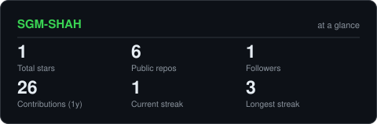
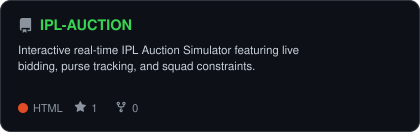
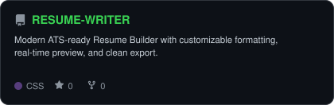
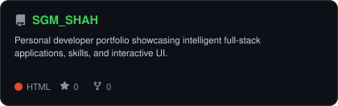
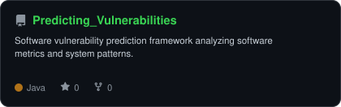

<div align="center">

<!-- PORTRAIT - generated by scripts/dotify.py from assets/avatar.png -->


<br>

<!-- NAME / TAGLINE - animated typing -->
<a href="https://github.com/SGM-SHAH">
  
</a>

<br>

<!-- SOCIALS & BADGES -->
<a href="https://linkedin.com/in/shaik-ghouse-mohiddin-shah"></a>
<a href="mailto:sgmshah07@gmail.com"></a>
<a href="https://sgm-shah.web.app/"></a>


</div>

---

## `~/` whoami

```console
$ cat about.txt
```

Hi, I'm **Shaik Ghouse Mohiddin Shah** (handle: **SGM SHAH**) — an aspiring **AI/ML Engineer** currently pursuing a **B.Tech in Computer Science and Engineering with a specialization in Artificial Intelligence and Machine Learning (CSE-AIML)** at **SRM University-AP**. I specialize in building intelligent, scalable systems and full-stack web applications, combining modern front-end engineering with machine learning and robust backend services.

- 🔭 Currently building: **[IPL Auction Simulator](https://ipl-auction-a81df.web.app/)** & **[ATS-Ready Resume Builder](https://resume-writer-sigma.vercel.app/)**
- 🌐 Developer Portfolio: **[sgm-shah.web.app](https://sgm-shah.web.app/)**
- 🏆 Hackathons & Highlights: **My1stHack 2025** • Tech and community events organizer
- 📜 Industry Certifications: **Software Engineering** • **Cybersecurity** • **Project Management**
- ⚡ Technical Toolbox: **Python, Java, C, C#, JavaScript, TypeScript, React, Next.js, Node.js, Express, Tailwind CSS, Firebase**
- 💡 Engineering Focus: **High-throughput data processing & algorithmic problem-solving**
- 🏏 Outside Engineering: **Watching cricket, debating, and reading books**

<br>

<div align="center">

## `~/` toolbox


</div>

---

<div align="center">

## `~/` skill radar

<table>
<tr>
<td width="50%" align="center" valign="middle">

<!-- Self-rated radar - edit assets/skills.json, the workflow redraws it -->
<picture>
  <source media="(prefers-color-scheme: dark)"  srcset="assets/radar-dark.svg">
  <source media="(prefers-color-scheme: light)" srcset="assets/radar-light.svg">
  
</picture>

</td>
<td width="50%" align="center" valign="middle">

<!-- Live radar built from real language byte counts across your repos -->
<picture>
  <source media="(prefers-color-scheme: dark)"  srcset="assets/radar-langs-dark.svg">
  <source media="(prefers-color-scheme: light)" srcset="assets/radar-langs-light.svg">
  
</picture>

</td>
</tr>
</table>

</div>

---

<div align="center">

## `~/` contribution calendar

<!-- 3D isometric calendar, regenerated every 6h by .github/workflows/metrics.yml -->


<br><br>

<!-- Snake eats the contribution graph - .github/workflows/snake.yml -->
<picture>
  <source media="(prefers-color-scheme: dark)"  srcset="https://raw.githubusercontent.com/SGM-SHAH/SGM-SHAH/output/snake-dark.svg">
  <source media="(prefers-color-scheme: light)" srcset="https://raw.githubusercontent.com/SGM-SHAH/SGM-SHAH/output/snake.svg">
  
</picture>

</div>

---

<div align="center">

## `~/` the numbers

<!-- Generated by scripts/cards.py into this repo. Deliberately self-hosted
     to prevent external API downtime from breaking profile badges. -->
<picture>
  <source media="(prefers-color-scheme: dark)"  srcset="assets/card-stats-dark.svg">
  <source media="(prefers-color-scheme: light)" srcset="assets/card-stats-light.svg">
  
</picture>

<br>


<br><br>


</div>

---

<div align="center">

## `~/` selected work

<!-- Cards generated by scripts/cards.py from assets/projects.json.
     Stars, forks and language are pulled live from the API on every run. -->
<table>
<tr>
<td width="50%">
  <a href="https://github.com/SGM-SHAH/IPL-AUCTION">
    <picture>
      <source media="(prefers-color-scheme: dark)"  srcset="assets/card-IPL-AUCTION-dark.svg">
      <source media="(prefers-color-scheme: light)" srcset="assets/card-IPL-AUCTION-light.svg">
      
    </picture>
  </a>
</td>
<td width="50%">
  <a href="https://github.com/SGM-SHAH/RESUME-WRITER">
    <picture>
      <source media="(prefers-color-scheme: dark)"  srcset="assets/card-RESUME-WRITER-dark.svg">
      <source media="(prefers-color-scheme: light)" srcset="assets/card-RESUME-WRITER-light.svg">
      
    </picture>
  </a>
</td>
</tr>
<tr>
<td width="50%">
  <a href="https://github.com/SGM-SHAH/SGM_SHAH">
    <picture>
      <source media="(prefers-color-scheme: dark)"  srcset="assets/card-SGM_SHAH-dark.svg">
      <source media="(prefers-color-scheme: light)" srcset="assets/card-SGM_SHAH-light.svg">
      
    </picture>
  </a>
</td>
<td width="50%">
  <a href="https://github.com/SGM-SHAH/Predicting_Vulnerabilities">
    <picture>
      <source media="(prefers-color-scheme: dark)"  srcset="assets/card-Predicting_Vulnerabilities-dark.svg">
      <source media="(prefers-color-scheme: light)" srcset="assets/card-Predicting_Vulnerabilities-light.svg">
      
    </picture>
  </a>
</td>
</tr>
</table>

<sub>

| project | live | stack |
|---|---|---|
| **[IPL-AUCTION](https://github.com/SGM-SHAH/IPL-AUCTION)** | [ipl-auction-a81df.web.app](https://ipl-auction-a81df.web.app/) | `JavaScript` `Node.js` `Express` `Firebase` |
| **[RESUME-WRITER](https://github.com/SGM-SHAH/RESUME-WRITER)** | [resume-writer-sigma.vercel.app](https://resume-writer-sigma.vercel.app/) | `React` `Next.js` `TypeScript` `Tailwind CSS` |
| **[SGM_SHAH](https://github.com/SGM-SHAH/SGM_SHAH)** | [sgm-shah.web.app](https://sgm-shah.web.app/) | `React` `Tailwind CSS` `Firebase` |
| **[Predicting_Vulnerabilities](https://github.com/SGM-SHAH/Predicting_Vulnerabilities)** | [github.com/SGM-SHAH/Predicting_Vulnerabilities](https://github.com/SGM-SHAH/Predicting_Vulnerabilities) | `Java` `Machine Learning` `Software Engineering` |

</sub>

</div>

---

<div align="center">

<sub>`01110100 01101000 01100001 01101110 01101011 01110011 00100000 01100110 01101111 01110010 00100000 01110011 01100011 01110010 01101111 01101100 01101100 01101001 01101110 01100111`</sub>

</div>
